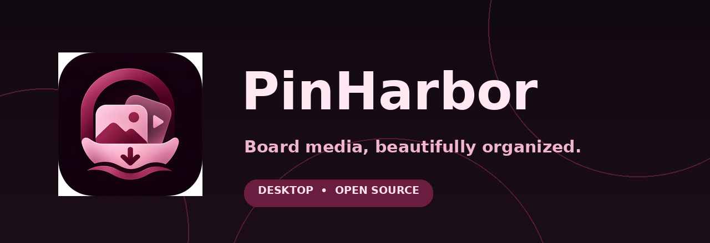

  

  # PinHarbor | پین‌هاربر

  **دریافت و مدیریت تصاویر و ویدیوهای بوردهای پینترست در دسکتاپ**

  **[English](README.md) · [راهنمای نصب](docs/INSTALL-FA.md) · [رفع مشکلات](docs/TROUBLESHOOTING-FA.md) · [تغییرات](CHANGELOG-FA.md)**

> پین‌هاربر یک پروژه مستقل است و به Pinterest وابستگی سازمانی ندارد. فقط محتوایی را دریافت کنید که مالک آن هستید یا مجوز استفاده از آن را دارید.

## معرفی

پین‌هاربر برای جمع‌آوری رسانه‌های **قابل دسترس** بوردهای Pinterest ساخته شده است. لینک بورد را وارد می‌کنید؛ برنامه با موتور `gallery-dl` و در صورت نیاز `yt-dlp` تصاویر و ویدیوها را دانلود می‌کند و در کتابخانه محلی نمایش می‌دهد.

### امکانات

- دانلود بورد و سکشن، ورود چند لینک و صف‌بندی با جست‌وجو و فیلتر.
- انتخاب فقط عکس یا ویدیو؛ آرشیو SQLite برای جلوگیری از دانلود تکراری.
- مشاهده فایل‌های ذخیره‌شده بدون آیکون‌ها و تصاویر داخلی برنامه، پیش‌نمایش، جست‌وجو، مرتب‌سازی و خروجی CSV.
- اعتبارسنجی زنده لینک‌ها، نمایش وضعیت هر بورد، توقف، ردکردن بورد جاری و اجرای مجدد بوردهای ناموفق.
- تنظیمات اختیاری کوکی مرورگر، پراکسی، مکث درخواست‌ها، محدودیت دانلود و تست آفلاین آمادگی.
- ظاهر تیره زرشکی/صورتی با جلوه شیشه‌ای سبک و فونت فارسی انتخابی.
- راهنمای کاربری و انتشار به دو زبان **فارسی و انگلیسی** (رابط خود نرم‌افزار فعلاً فارسی است).

**محدودیت مهم:** دریافت تمامی پین‌ها در هر شرایطی تضمین نمی‌شود؛ بوردهای خصوصی، فایل‌های حذف‌شده، ویدیوهای دارای لینک منقضی یا محدودیت‌های سرویس ممکن است قابل دانلود نباشند. نوار پیشرفت براساس تعداد بوردهای پردازش‌شده است، نه درصد همه فایل‌های یک بورد.

## دانلود کدام فایل؟

| فایل | مناسب برای | نیاز به Python |
|---|---|---|
| **Windows portable ZIP / EXE** | کاربر عادی؛ بعد از ساخته‌شدن و انتشار در GitHub Releases | خیر |
| **Source ZIP** | اجرا با سورس؛ قابل استفاده همین حالا | بله؛ ۳.۱۰ به بالا |
| **Update ZIP** | ارتقای نسخه‌های سورسی قبلی ۲.x | بله؛ مانند نصب فعلی |

بسته‌های انتشار را از بخش [Releases](../../releases) همین ریپازیتوری دریافت کنید. فایل خودکار **Source code (zip)** گیت‌هاب با نسخه آماده ویندوز تفاوت دارد. تا وقتی بسته EXE ساخته و منتشر نشده، از نسخه سورس استفاده کنید.

**نصب سریع:** ZIP سورس را در یک پوشه قابل‌نوشتن استخراج کنید؛ فایل `Run on Windows.bat` را اجرا کنید؛ لینک بورد را وارد کنید و دکمه «دانلود از لینک‌ها» را بزنید. نصب وابستگی‌ها در اولین اجرا به اینترنت نیاز دارد.

## آپدیت روی نرم‌افزار قبلی

برنامه را ببندید. فایل **Update ZIP** را در یک پوشه *جداگانه* استخراج کنید و `Upgrade Existing Installation.bat` را اجرا کنید. پوشه برنامه قدیمی را انتخاب کنید؛ اطلاعات صف، آرشیو SQLite و تصاویر دست‌نخورده می‌ماند. برای بازگشت از `Rollback Last Update.bat` در پوشه آپدیت‌شده استفاده کنید. این شیوه برای نصب سورسی است و **نسخه EXE را آپدیت نمی‌کند**. [جزئیات کامل](docs/INSTALL-FA.md).

## انتشار ساده در GitHub برای توسعه‌دهنده

پس از نصب Git و GitHub CLI و اجرای `gh auth login`، از فایل **`Publish to GitHub.bat`** استفاده کنید. این ابزار انتشار سورس را مرحله‌به‌مرحله و فقط بعد از تأیید نهایی انجام می‌دهد. فایل‌های شخصی، کوکی‌ها و آرشیو دانلود انتخاب نمی‌شوند. [راهنمای انتشار فارسی](docs/ONE-CLICK-PUBLISH-FA.md) · [English](docs/ONE-CLICK-PUBLISH-EN.md).

## طراحی و هویت بصری

رنگ‌ها: زرشکی `#721F43`، صورتی پاستلی `#F0B6CB`، مشکی `#120A11`. گلس‌مورفیسم از سطوح نیمه‌شفاف و گرادیان استفاده می‌کند، نه Blur واقعی و سنگین. برای کیفیت بهتر تایپوگرافی، نصب فونت [Vazirmatn](https://github.com/rastikerdar/vazirmatn) پیشنهاد می‌شود. فایل فونت داخل پروژه توزیع نشده است. تصویر بالا آیکون برند است و **اسکرین‌شات محیط نرم‌افزار نیست**.

## مشارکت، گزارش باگ و حریم خصوصی

برای خطاها از [Issues](../../issues)، برای پیشنهاد امکانات از قالب Feature Request استفاده کنید. پیش از ارسال لاگ، اطلاعات حساب، کوکی‌ها، رمز و آدرس کامل پراکسی را حذف کنید. راهنماها: [رفع مشکل](docs/TROUBLESHOOTING-FA.md)، [حریم خصوصی](docs/PRIVACY-FA.md)، [مشارکت](CONTRIBUTING.md)، [مجوز](LICENSE)، [کتابخانه‌های ثالث](THIRD-PARTY.md).

**وضعیت تست:** تست‌های آفلاین و سازگاری آپدیت قابل اجرا هستند، ولی عملکرد واقعی Windows GUI، بورد زنده و فایل EXE باید قبل از انتشار عمومی توسط نگه‌دارنده روی سیستم ویندوز بررسی شوند.

**مجوزها:** پیش از انتشار عمومی EXE، الزامات GPL مربوط به gallery-dl و مجوزهای Qt و FFmpeg باید بررسی شوند. [توضیحات](NOTICE.md).
