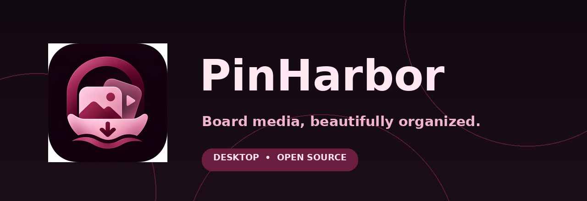
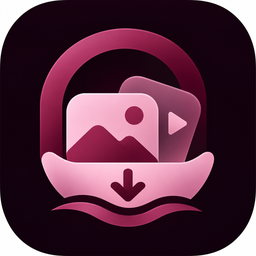

<div align="center">
  

  # PinHarbor

  **A local-first desktop downloader for accessible Pinterest board images and videos.**

  **[English](README.md) · [فارسی](README-FA.md) · [Installation](docs/INSTALL-EN.md) · [Support](SUPPORT.md) · [Changelog](CHANGELOG.md)**

    
</div>

> **Independent project:** not affiliated with, approved by, or sponsored by Pinterest. Only download content you own or have permission to use.

## Why PinHarbor?

Paste a board URL, queue multiple boards, and save accessible images and videos into organized local folders. PinHarbor includes a visual download library and a burgundy-and-rose desktop interface, powered by Python/PySide6, [gallery-dl](https://github.com/mikf/gallery-dl) and [yt-dlp](https://github.com/yt-dlp/yt-dlp).

### What works today

- Board and board-section URLs from supported Pinterest domains; bulk queue with search, filtering, reordering and live URL validation.
- Image/video filtering, downloadable-media archive that prevents repeat downloads, and restartable jobs.
- Local gallery with thumbnails, search, sorting, video preview support and CSV export.
- Download status, cancel current job, skip board, offline health check, diagnostics and error guidance.
- Optional browser cookies, proxy, request pacing and download limits.
- Local-first settings; per-file update integrity verification and rollback for source-based v2.x installations.
- Persian desktop interface; **English and Persian documentation**. The **interface is not yet translated to English**.

**Limitations:** Not every private/expired/restricted pin can be downloaded. Output quality and availability depend on what Pinterest and gallery-dl expose. The progress bar measures processed boards, not the unknown number of Pins. Restarting an interrupted job is not guaranteed byte-level resume. FFmpeg may be necessary for some videos.

## Download / install

| Package | Audience | Python required? |
|---|---|---|
| **Windows portable ZIP (EXE)** | End users | No; generated by the Windows GitHub Actions release workflow, **not included in this source repository ZIP** |
| **Source ZIP** | Windows users / developers | Yes, Python 3.10+; double-click `Run on Windows.bat` |
| **Update ZIP** | Existing v2.x source-based users | Yes, as in your old installation; use `Upgrade Existing Installation.bat` |

**Download published builds from the repository's [Releases](../../releases) page.** GitHub's automatic “Source code (zip)” is not the packaged Windows application. Until a Windows Release asset is actually built and published, install from source.

**First-time users:** download the Windows portable ZIP after the GitHub Actions workflow has built it. Use the Source ZIP if you want to run Python directly.

**Quick start (source on Windows):** extract to a writable folder → run `Run on Windows.bat` → paste a full board URL such as `https://www.pinterest.com/username/board-name/` → click **«دانلود از لینک‌ها»**. Dependencies are installed on first run. See [the full installation guide](docs/INSTALL-EN.md).

### Update without losing your existing data

1. Close the old program.
2. Extract the **Update ZIP into a different folder**.
3. Run `Upgrade Existing Installation.bat` there and select your old program folder.
4. Start the updated program from your original folder. Roll back via `Rollback Last Update.bat` if necessary.

The updater targets **source/Batch installations**, not previously compiled EXE bundles. It preserves downloaded media, the SQLite archive and the legacy Qt settings identity (`PinterestBoardStudio/Desktop`). See [upgrade details](docs/INSTALL-EN.md#updating-from-an-older-source-installation).

## One-command GitHub publishing (maintainers)

After installing Git and GitHub CLI and authenticating with `gh auth login`, double-click `Publish to GitHub.bat` for a guided, explicitly confirmed source upload. It selects only curated project files, never local media or account data. Preview without publishing via `python tools/github_publish.py --repo pinharbor`. See [English guide](docs/ONE-CLICK-PUBLISH-EN.md) · [راهنمای فارسی](docs/ONE-CLICK-PUBLISH-FA.md).

## UI & branding



Palette: `#721F43` burgundy · `#F0B6CB` pastel rose · `#120A11` near black. Soft translucent layers evoke glassmorphism; this is **not a per-widget live background blur**. If installed, Vazirmatn is the preferred Persian font; the font is **not redistributed** in this repository. The image above is brand artwork, **not a product screenshot**.

## Build and tests

```bash
python -m pip install -r requirements.txt
python -m unittest discover -s tests -v
```

On Windows, run `Build EXE (Windows).bat` after `Run on Windows.bat` to compile a *one-folder* PyInstaller application. The CI workflow builds a portable Windows ZIP from that output on Windows runners. Linux/macOS **binaries are not currently provided**.

GitHub Actions runs tests on Windows and Linux and (on release tags) packages a Windows portable ZIP, a source ZIP, an update ZIP and SHA-256 hashes. Actual Pinterest downloads and GUI operation on a user Windows machine require manual verification; [see the release checklist](docs/RELEASE-CHECKLIST.md).

## Community

Found an issue? Use [Bug report](.github/ISSUE_TEMPLATE/bug_report.yml) or the repository Issues tab. Suggestions are welcome via [Feature request](.github/ISSUE_TEMPLATE/feature_request.yml). Read [CONTRIBUTING.md](CONTRIBUTING.md), [SUPPORT.md](SUPPORT.md), [SECURITY.md](SECURITY.md) the [roadmap](ROADMAP.md) and the [Code of Conduct](CODE_OF_CONDUCT.md) before submitting reports or changes. **Remove any credentials, proxy URLs and browser/session cookies from logs and screenshots.**

## Privacy, rights & attribution

Media and download state are stored locally, but the application and its download engines make network requests to Pinterest and related content hosts. Selecting browser cookies allows the download engine to use local authentication cookies; users control that action. See [Privacy](docs/PRIVACY-EN.md), [Third-party components](THIRD-PARTY.md) and [License](LICENSE).

Copyright in downloaded content belongs to its rights holders. Please respect copyright law and platform terms. No Pinterest trademarks or brand assets are used as the PinHarbor logo.

**Distribution caution:** The app’s MIT license does not supersede gallery-dl’s GPL-2.0-only or Qt/FFmpeg licenses. Inspect [NOTICE.md](NOTICE.md) before publicly distributing compiled builds.
